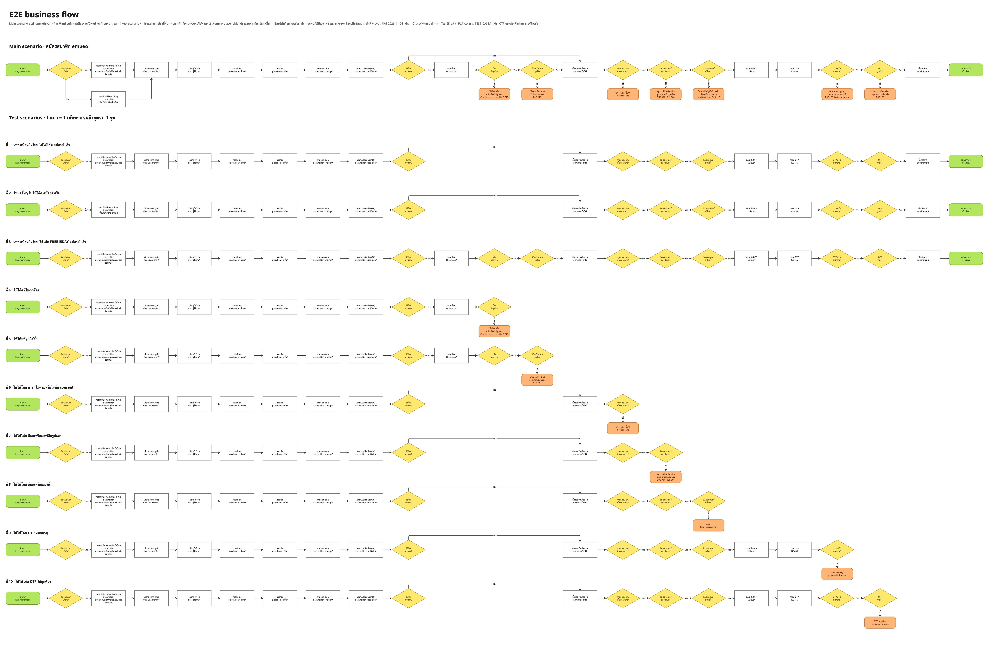

# empeo registration - automation tests

Playwright + TypeScript tests for the empeo sign-up page https://portal.uat.gofive.co.th/Register/empeo (UAT).

1. [Test scope](#1-test-scope)
2. [Test cases](#2-test-cases)
3. [Test scenarios](#3-test-scenarios)
4. [Test results](#4-test-results)
5. [Bugs found](#5-bugs-found)
6. [How to run](#6-how-to-run)
7. [Result report and videos](#7-result-report-and-videos)

## 1. Test scope

**In scope** - the whole sign-up journey of one new company on the empeo registration page:
- Company type: `บริษัทจดทะเบียนในไทย` (Thai-registered company, search by tax ID or name) and `อื่นๆ` (Others, company name typed in)
- Fields and their validation: company search, business type, number of users, email, first name, last name, mobile phone (country code), promo code, consent checkbox, required-field errors (Thai and English)
- Submit (`POST /api/v2/register`), OTP (correct, wrong, resend, expired), create password (rules, confirmation, API failure), success page, sign in with the new account and preboarding
- Edge cases from the exam brief: wrong phone format, expired OTP, reused promo code, reused phone / email

**Not in scope** - other empeo pages, performance, security testing, responsive / mobile layout, browsers other than Chromium, the content of the real SMS.

**Numbers** - 146 test cases (BUS-001 to BUS-146) grouped into 14 test scenarios (M1 to M14). Cases were first executed by hand on UAT on 2026-11-03/04: 118 matched the expected result, 23 are findings, 5 are tbc (not decided or not tried). The automation runs the 14 scenarios.

**Test data** (fixed by the exam brief): phone `0967690708`, OTP `123456`, promo `FREE15DAY`. Everything else is generated per run (fresh email and company).

## 2. Test cases

All 146 cases with steps are in [TEST_CASES.md](TEST_CASES.md). Note = the test scenario (M1-M14) that runs the case; `finding` = UAT differs from the expected result or the spec is unconfirmed; `tbc` = not decided yet.

| Test ID | Test case | Test data | Expected result | Note |
|---|---|---|---|---|
| BUS-001 | Verify default company type radio | - | 1. The registration page shows the form<br>2. The `บริษัทจดทะเบียนในไทย` radio is selected by default; the `อื่นๆ` radio is not selected<br>3. placeholder = `กรอกเลขประจำตัวผู้เสียภาษี หรือ ชื่อบริษัท` (EN: Fill in tax ID or company name) | M1 Success - no promo |
| BUS-002 | Verify selecting Others radio | - | 1. The `อื่นๆ` radio is selected; the `บริษัทจดทะเบียนในไทย` radio is not selected<br>2. placeholder = `ชื่อบริษัท*` (EN: Company Name*) | M1 Success - no promo |
| BUS-003 | Verify additional-information API call | - | 1. GET /api/register/additional-information is called once (no query), returns 200, status.code 1000, and data contains companyType, userAmount, experience<br>2. additional-information is not called again<br>3. additional-information is not called again | M1 Success - no promo |
| BUS-004 | Verify search by existing Thai company name | `ซีพี` | 1. GET /api/register/tax-search?text=ซีพี is called, returns 200 with data.taxInfo<br>2. A list is shown; each item has the company name (upper line) and the 13-digit tax ID (lower line), in the order the API sends them | M1 Success - no promo · finding |
| BUS-005 | Verify search by existing English company name | `TURKMENISTAN` | 1. tax-search is called, returns 200 with data.taxInfo containing 1 item<br>2. 1 item is shown: `TURKMENISTAN AIRLINES Open Joint-Stock Company`, ID 0993000277309 | M1 Success - no promo |
| BUS-006 | Verify search by non-existent company name | `zzqqxx999` | 1. tax-search is called, returns 200<br>2. No list is shown, no message, no error | M1 Success - no promo · finding |
| BUS-007 | Verify search with fewer than 3 characters | `กา`, `TU` | 1. The frontend calls tax-search and the backend returns 200 with data = null<br>2. No list is shown | M1 Success - no promo |
| BUS-008 | Verify search with exactly 3 characters | `การ`, `TUR` | 1. tax-search is called, returns 200 with data.taxInfo<br>2. A list is shown (การ: API returns 100, page shows 30; TUR: API returns 41, page shows 29) | M1 Success - no promo |
| BUS-009 | Verify search with more than 3 characters | `การบิน`, `TURK` | 1. tax-search is called, returns 200 with data.taxInfo<br>2. The list narrows according to the typed text (การบิน: API returns 100, page shows 18; TURK: 1 item) | M1 Success - no promo |
| BUS-010 | Verify search with tax ID fewer than 13 digits | `0105545` (7), `010554506883` (12) | 1. tax-search is called, returns 200 with data = null<br>2. No list is shown | M1 Success - no promo |
| BUS-011 | Verify search with tax ID of exactly 13 digits | `0105545068839` | 1. tax-search is called, returns 200 with data.taxInfo containing 1 item<br>2. 1 item is shown: `บริษัท ซีพีซี อินเตอร์เนชั่นแนล (ประเทศไทย) จำกัด`, ID 0105545068839 | M1 Success - no promo |
| BUS-012 | Verify search with tax ID more than 13 digits | `01055450688391` (14) | 1. tax-search is called, returns 200 with data = null<br>2. No list is shown | M1 Success - no promo |
| BUS-013 | Verify search with Japanese characters | `テスト` and mock company `テスト株式会社` ID 9999999999991 | 1. The field shows テスト in full (not as boxes); tax-search is called, returns 200<br>2. No list is shown (no data in the system, not a field error)<br>3. The next tax-search request is answered with the mock data<br>4. 1 item is shown: テスト株式会社, ID 9999999999991; the Japanese characters display correctly<br>5. The field shows the ID 9999999999991, no error appears, and POST /api/v2/register/duplicateInfo/ is called with text = テスト株式会社 | M1 Success - no promo |
| BUS-014 | Verify search with special characters | `!@#$%^&*(),.`, `,.` | 1. The field shows the full text (including , and .); tax-search is called, returns 200 with data = null<br>2. No list is shown; the page does not break | M1 Success - no promo |
| BUS-015 | Verify search with mixed languages | `Test บริษัท` | 1. The field shows the full text; tax-search is called, returns 200<br>2. No list is shown | M1 Success - no promo |
| BUS-016 | Verify search with exactly 255 characters | `ก` x 255 | 1. The field accepts all 255 characters (maxlength 255)<br>2. No list is shown; the page does not break | M1 Success - no promo |
| BUS-017 | Verify search with more than 255 characters | `ก` x 256 | 1. The field does not accept the 256th character<br>2. The field contains 255 characters | M1 Success - no promo |
| BUS-018 | Verify search with spaces only | 5 spaces | 1. The field contains 5 spaces<br>2. tax-search is not called, no list is shown | M1 Success - no promo · finding |
| BUS-019 | Verify full company name typed without selecting | `บริษัท ซีพีซี อินเตอร์เนชั่นแนล (ประเทศไทย) จำกัด` | 1. A list with 1 item is shown, but nothing is selected yet<br>2. This field shows `กรุณากรอกเลขประจำตัวผู้เสียภาษีหรือชื่อบริษัท` (EN: Please fill in Tax ID or company name) | M5 Missing required |
| BUS-020 | Verify search field left empty | - | 1. This field shows `กรุณากรอกเลขประจำตัวผู้เสียภาษีหรือชื่อบริษัท` (EN: Please fill in Tax ID or company name) | M5 Missing required |
| BUS-021 | Verify duplicateInfo API call on company selection | `0105545068839` select the first item | 1. A list with 1 item is shown<br>2. The field shows the tax ID 0105545068839 and no error appears on this field<br>3. POST /api/v2/register/duplicateInfo/ is called with body {text: full company name, email: the email value in the form (may be empty), infoTypeName: CompanyName, productId: 102}, returns 200 with data.isDuplicate = false | M1 Success - no promo |
| BUS-022 | Verify business type options against API | - | 1. companyType has 25 items, id 23001 to 23025<br>2. 25 options are shown<br>3. The order matches the API for every item (`ค้าปลีก, eCommerce, เทคโนโลยี, ซอฟต์แวร์ การพัฒนาแอพ, Infrastructure, บริการด้านไอที, อุตสาหกรรม/โรงงาน, การก่อสร้าง, โรงแรม, ยานยนต์, โลจิสติกส์, นำเข้าและส่งออก, สุขภาพ, การแพทย์และร้านยา, อาหารและเครื่องดื่ม, การเงินและประกันภัย, สื่อและการตลาด, อิเล็กทรอนิกส์, องค์กรภาครัฐ, มูลนิธิสมาคมและศูนย์วิจัย, การศึกษาและการฝึกอบรม, อสังหาริมทรัพย์, บัญชี, บริการ, อื่นๆ`)<br>4. Same order, text in English (Wholesale, eCommerce, Technology, ... , Service, other) | M1 Success - no promo · finding |
| BUS-023 | Verify business type dropdown without selection | - | 1. The option list opens<br>2. The list closes, the field still shows `ประเภทธุรกิจ*` and `กรุณากรอกประเภทธุรกิจ` (EN: Please fill in your business type) appears immediately | M5 Missing required |
| BUS-024 | Verify business type selection | `eCommerce` | 1. The list opens<br>2. The list closes, the field shows eCommerce and no error appears<br>3. The field changes to `เทคโนโลยี`<br>4. The field still shows `เทคโนโลยี` (the selection is not cleared) | M1 Success - no promo |
| BUS-025 | Verify user amount dropdown without selection | - | 1. The list opens<br>2. 8 options are shown: 1-20, 21-50, 51-100, 101-200, 201-500, 501-1,000, 1,001-5,000, 5,001+, matching the API items with seq = 2 (id 22006-22010, 22016, 22017, 22018) in API order<br>3. The list closes, the field shows `ผู้ใช้งาน*` (EN: Number of employee*) and `กรุณากรอกผู้ใช้งาน` (EN: Please fill in number of employee?) appears | M5 Missing required |
| BUS-026 | Verify user amount selection | `21-50` | 1. The list opens<br>2. The list closes, the field shows 21-50 and no error appears<br>3. The field changes to 51-100 | M1 Success - no promo |
| BUS-027 | Verify email with valid format and unregistered domain | `qa.empeo+t1@gmail.com` | 1. No email field error appears while typing<br>2. POST /api/v2/register/DuplicateEmail is called and returns 200 with data false, no email field error appears | M1 Success - no promo |
| BUS-028 | Verify email with already registered domain | `qa.tester@example.com`, `qa.automation.test@mailinator.com` | 1. The field contains the entered value<br>2. `โดเมนนี้มีบัญชีใช้งานแล้ว` (EN: This domain is already in use.) appears | M7 Duplicate email |
| BUS-029 | Verify email with Thai characters | `ทดสอบ@gmail.com` | 1. The field shows the full value<br>2. `กรุณาใส่อีเมลที่ถูกต้อง` (EN: Please enter a valid email address.) appears | M6 Invalid email or phone |
| BUS-030 | Verify email with English characters | `qa.tester@gmail.com` | 1. The field shows the full value<br>2. No email field error appears | M6 Invalid email or phone |
| BUS-031 | Verify email with Japanese characters | `テスト@gmail.com` | 1. The field shows the full value<br>2. `กรุณาใส่อีเมลที่ถูกต้อง` (EN: Please enter a valid email address.) appears | M6 Invalid email or phone |
| BUS-032 | Verify email with special characters | qa+tag_!#$%&'*/=?^`{\ | 1. Enter an email containing several special characters<br>2. Click the `ทดลองใช้ฟรี` (EN: Try for free) button | M6 Invalid email or phone |
| BUS-033 | Verify email with digits only | `12345678@gmail.com` | 1. The field shows the full value<br>2. `กรุณาใส่อีเมลที่ถูกต้อง` (EN: Please enter a valid email address.) appears (a Gmail username must contain at least 1 letter) | M6 Invalid email or phone · finding |
| BUS-034 | Verify email with invalid formats | `not-an-email`, `a@b`, `a@b.`, `qa.tester@example`, `@example.com`, `qa@@example.com` | 1. The field shows the full value<br>2. `กรุณาใส่อีเมลที่ถูกต้อง` (EN: Please enter a valid email address.) appears | M6 Invalid email or phone |
| BUS-035 | Verify email with exactly 150 characters | `a` x 140 + `@gmail.com` | 1. The field accepts all 150 characters<br>2. No email field error appears | M1 Success - no promo |
| BUS-036 | Verify email with more than 150 characters | `a` x 141 + `@gmail.com` (151 characters) | 1. The field does not accept the 151st character<br>2. The field contains 150 characters | M6 Invalid email or phone · finding |
| BUS-037 | Verify email with spaces only | 5 spaces | 1. The field contains 5 spaces<br>2. `กรุณาใส่อีเมลที่ถูกต้อง` (EN: Please enter a valid email address.) appears | M6 Invalid email or phone |
| BUS-038 | Verify email left empty | - | 1. `กรุณากรอกอีเมล` (EN: Please fill in e-mail) appears | M5 Missing required |
| BUS-039 | Verify email click in and click out | - | 1. The cursor is in the field, no error yet<br>2. A red error `กรุณากรอกอีเมล` (EN: Please fill in e-mail) appears below the email field immediately, without submitting | M6 Invalid email or phone |
| BUS-040 | Verify email real-time inline error update | `q`, `qa@b.co` | 1. The cursor is in the field, no error yet<br>2. `กรุณากรอกอีเมล` (EN: Please fill in e-mail) appears<br>3. The error changes to `กรุณาใส่อีเมลที่ถูกต้อง` (EN: Please enter a valid email address.) immediately<br>4. The error remains `กรุณาใส่อีเมลที่ถูกต้อง` on every character until the format is valid, then disappears<br>5. `กรุณากรอกอีเมล` appears again immediately | M6 Invalid email or phone |
| BUS-041 | Verify first name with Thai characters | `ทดสอบ` | 1. The field shows the full value<br>2. No first name field error appears | M1 Success - no promo |
| BUS-042 | Verify first name with English characters | `Tester` | 1. The field shows the full value<br>2. No first name field error appears | M1 Success - no promo |
| BUS-043 | Verify first name with Japanese characters | `テスト` | 1. The field shows the full value<br>2. No first name field error appears | M1 Success - no promo |
| BUS-044 | Verify first name with special characters | `!@#$%^&*()<>"'/\.,-` | 1. The field shows the full value<br>2. No first name field error appears | M1 Success - no promo · finding |
| BUS-045 | Verify first name with mixed languages | `Test ทดสอบ テスト` | 1. The field shows the full value<br>2. No first name field error appears | M1 Success - no promo |
| BUS-046 | Verify first name with digits | `12345` | 1. The field shows the full value<br>2. No first name field error appears | M1 Success - no promo · finding |
| BUS-047 | Verify first name with exactly 255 characters | `ก` x 255 | 1. The field accepts all 255 characters<br>2. No first name field error appears | M1 Success - no promo |
| BUS-048 | Verify first name with more than 255 characters | `ก` x 256 | 1. The field does not accept the 256th character<br>2. The field contains 255 characters | M1 Success - no promo |
| BUS-049 | Verify first name with spaces only | 3 spaces | 1. The field contains 3 spaces<br>2. `กรุณากรอกชื่อ` (EN: Please fill in first name) should appear | M1 Success - no promo · finding |
| BUS-050 | Verify first name left empty | - | 1. `กรุณากรอกชื่อ` (EN: Please fill in first name) appears | M5 Missing required |
| BUS-051 | Verify first name click in and click out | - | 1. The cursor is in the field, no error yet<br>2. A red error `กรุณากรอกชื่อ` (EN: Please fill in first name) appears below the first name field immediately, without submitting | M5 Missing required |
| BUS-052 | Verify first name real-time inline error update | `ก` | 1. The cursor is in the field, no error yet<br>2. `กรุณากรอกชื่อ` (EN: Please fill in first name) appears<br>3. The error disappears immediately<br>4. `กรุณากรอกชื่อ` appears again immediately | M5 Missing required |
| BUS-053 | Verify last name with Thai characters | `ทดสอบ` | 1. The field shows the full value<br>2. No last name field error appears | M1 Success - no promo |
| BUS-054 | Verify last name with English characters | `Tester` | 1. The field shows the full value<br>2. No last name field error appears | M1 Success - no promo |
| BUS-055 | Verify last name with Japanese characters | `テスト` | 1. The field shows the full value<br>2. No last name field error appears | M1 Success - no promo |
| BUS-056 | Verify last name with special characters | `!@#$%^&*()<>"'/\.,-` | 1. The field shows the full value<br>2. No last name field error appears | M1 Success - no promo · finding |
| BUS-057 | Verify last name with mixed languages | `Test ทดสอบ テスト` | 1. The field shows the full value<br>2. No last name field error appears | M1 Success - no promo |
| BUS-058 | Verify last name with digits | `12345` | 1. The field shows the full value<br>2. No last name field error appears | M1 Success - no promo · finding |
| BUS-059 | Verify last name with exactly 255 characters | `ก` x 255 | 1. The field accepts all 255 characters<br>2. No last name field error appears | M1 Success - no promo |
| BUS-060 | Verify last name with more than 255 characters | `ก` x 256 | 1. The field does not accept the 256th character<br>2. The field contains 255 characters | M1 Success - no promo |
| BUS-061 | Verify last name with spaces only | 3 spaces | 1. The field contains 3 spaces<br>2. `กรุณากรอกนามสกุล` (EN: Please fill in last name) should appear | M1 Success - no promo · finding |
| BUS-062 | Verify last name left empty | - | 1. `กรุณากรอกนามสกุล` (EN: Please fill in last name) appears | M5 Missing required |
| BUS-063 | Verify last name click in and click out | - | 1. The cursor is in the field, no error yet<br>2. A red error `กรุณากรอกนามสกุล` (EN: Please fill in last name) appears below the last name field immediately, without submitting | M5 Missing required |
| BUS-064 | Verify last name real-time inline error update | `ก` | 1. The cursor is in the field, no error yet<br>2. `กรุณากรอกนามสกุล` (EN: Please fill in last name) appears<br>3. The error disappears immediately<br>4. `กรุณากรอกนามสกุล` appears again immediately | M5 Missing required |
| BUS-065 | Verify Thai phone number with leading 0 | +66 `0812345678` | 1. The field shows the full number<br>2. No error on the phone field | M1 Success - no promo |
| BUS-066 | Verify Thai phone number without leading 0 | +66 `812345678` | 1. The field shows the full number<br>2. No error on the phone field | M1 Success - no promo |
| BUS-067 | Verify phone number matching another country code | +81 `09012345678` | 1. Country code changes to +81<br>2. The field shows the full number<br>3. No error on the phone field | M1 Success - no promo |
| BUS-068 | Verify Thai country code with Japanese-format number | Country: Thailand (+66) · Number: `09012345678` (Japanese format) | 1. Country code +66 is shown<br>2. The field shows the full number<br>3. `รูปแบบเบอร์โทรศัพท์ไม่ถูกต้อง` (EN: Invalid mobile number) is shown | M6 Invalid email or phone |
| BUS-069 | Verify Japan country code with Thai-format number | Country: Japan (+81) · Number: `0812345678` (Thai format) | 1. Country code changes to +81<br>2. The field shows the full number<br>3. `รูปแบบเบอร์โทรศัพท์ไม่ถูกต้อง` (EN: Invalid mobile number) is shown | M6 Invalid email or phone |
| BUS-070 | Verify Thai country code with 11 digits | Country: Thailand (+66) · Number: `08123456789` (11 digits, exceeds the 10-digit Thai number with leading 0) | 1. Country code +66 is shown<br>2. The field shows the full 11 digits<br>3. `รูปแบบเบอร์โทรศัพท์ไม่ถูกต้อง` (EN: Invalid mobile number) is shown | M6 Invalid email or phone |
| BUS-071 | Verify phone number exceeding field max length | `12345678901234567890` (20 digits) | 1. The field does not accept more than 15 digits<br>2. The field contains 15 digits (maxlength = 15)<br>3. `รูปแบบเบอร์โทรศัพท์ไม่ถูกต้อง` (EN: Invalid mobile number) is shown | M6 Invalid email or phone |
| BUS-072 | Verify phone number shorter than country format | +66 `081234567` (9 digits with leading 0), `12345` | 1. The field shows the full number<br>2. `รูปแบบเบอร์โทรศัพท์ไม่ถูกต้อง` (EN: Invalid mobile number) is shown | M6 Invalid email or phone |
| BUS-073 | Verify typing letters in phone field | `abc` (typed via keyboard) | 1. The field does not accept letters, it stays empty<br>2. `กรุณากรอกเบอร์โทรศัพท์มือถือ` (EN: Please fill in your mobile number) is shown | M6 Invalid email or phone |
| BUS-074 | Verify phone number left empty | - | 1. `กรุณากรอกเบอร์โทรศัพท์มือถือ` (EN: Please fill in your mobile number) is shown | M5 Missing required |
| BUS-075 | Verify phone click in and click out | - | 1. The cursor is in the field, no error yet<br>2. A red error `กรุณากรอกเบอร์โทรศัพท์มือถือ` (EN: Please fill in your mobile number) appears under the phone field immediately, without submitting | M6 Invalid email or phone |
| BUS-076 | Verify phone real-time inline error update | Country: Thailand (+66) · `0`, `0812345678` | 1. The cursor is in the field, no error yet<br>2. `กรุณากรอกเบอร์โทรศัพท์มือถือ` (EN: Please fill in your mobile number) is shown<br>3. The error changes to `รูปแบบเบอร์โทรศัพท์ไม่ถูกต้อง` (EN: Invalid mobile number) immediately<br>4. The error stays `รูปแบบเบอร์โทรศัพท์ไม่ถูกต้อง` from digit 1 to 9 and disappears at 10 digits<br>5. `กรุณากรอกเบอร์โทรศัพท์มือถือ` is shown again immediately | M6 Invalid email or phone |
| BUS-077 | Verify applying an existing promo code | `FREE15DAY` | 1. The code field disappears<br>2. coupon-validation is called and returns 200 data.isValid = true, description free 15 days for every Package<br>3. A FREE15DAY chip with an X button is shown | M2 Success - FREE15DAY |
| BUS-078 | Verify applying a non-existent promo code | `INVALIDCODE123` | 1. `คูปองโค้ดไม่ถูกต้อง` (EN: Invalid promo code) is shown, the code field remains<br>2. coupon-validation is called and returns 400 status.code 4001 subCode E1104 | M3 Invalid promo |
| BUS-079 | Verify applying a lowercase promo code | `free15day` | 1. Passes, the chip shows the text as typed (free15day), the server returns couponCode = FREE15DAY | M2 Success - FREE15DAY |
| BUS-080 | Verify promo code with Thai characters | `ทดสอบ` | 1. Nothing changes, no error, the code field remains<br>2. coupon-validation is not called | M3 Invalid promo · finding |
| BUS-081 | Verify promo code with Japanese characters | `テスト` | 1. Nothing changes, no error<br>2. coupon-validation is not called | M3 Invalid promo · finding |
| BUS-082 | Verify promo code with special characters | `!@#$%^&*()` | 1. Nothing changes, no error<br>2. coupon-validation is not called | M3 Invalid promo · finding |
| BUS-083 | Verify promo code with mixed languages | `Test ทดสอบ テスト` | 1. `คูปองโค้ดไม่ถูกต้อง` (EN: Invalid promo code) is shown<br>2. coupon-validation is called and returns 400 E1104 | M3 Invalid promo |
| BUS-084 | Verify promo code with digits | `12345` | 1. `คูปองโค้ดไม่ถูกต้อง` (EN: Invalid promo code) is shown (returns 400 E1104) | M3 Invalid promo |
| BUS-085 | Verify promo code with exactly 50 characters | `A` x 50 | 1. The field accepts all 50 characters, no error yet<br>2. Inline error `คูปองโค้ดไม่ถูกต้อง` (EN: Invalid promo code) appears under the code field because the code does not exist, not because of the length<br>3. coupon-validation is called with the 50-character code and returns 400 E1104 | M3 Invalid promo |
| BUS-086 | Verify promo code with more than 50 characters | `A` x 51 | 1. The field does not accept the 51st character<br>2. The field contains 50 characters, no inline error until Apply is clicked | M3 Invalid promo |
| BUS-087 | Verify promo code with spaces only | 3 spaces | 1. Nothing changes, no error<br>2. coupon-validation is not called | M3 Invalid promo · finding |
| BUS-088 | Verify existing promo code with surrounding spaces | ` FREE15DAY ` | 1. `คูปองโค้ดไม่ถูกต้อง` (EN: Invalid promo code) is shown<br>2. coupon-validation is called with the value including spaces (not trimmed) and returns 400 E1104 | M3 Invalid promo · finding |
| BUS-089 | Verify Apply with empty promo field | - | 1. Nothing changes, no error<br>2. coupon-validation is not called | M1 Success - no promo |
| BUS-090 | Verify promo click in and click out | - | 1. The cursor is in the field<br>2. No error (the code field is optional) | M3 Invalid promo |
| BUS-091 | Verify promo real-time inline error update | `INVALIDCODE123` then type `X` | 1. The cursor is in the field, no error yet<br>2. No error yet (the code field is optional)<br>3. `คูปองโค้ดไม่ถูกต้อง` (EN: Invalid promo code) is shown<br>4. The error disappears immediately<br>5. No error | M3 Invalid promo |
| BUS-092 | Verify closing promo chip and re-entering code | `FREE15DAY` | 1. The chip disappears, the code field and Apply button return immediately (no need to click the link again) | M2 Success - FREE15DAY |
| BUS-093 | Verify accepting terms checkbox | - | 1. The checkbox is not ticked and there is no error<br>2. The checkbox is ticked, no consent error is shown | M1 Success - no promo |
| BUS-094 | Verify not accepting terms checkbox | - | 1. `กรุณารับทราบนโยบายความเป็นส่วนตัว และข้อกำหนดและเงื่อนไขการใช้งาน` (EN: Please accept the Privacy Policy and Terms and Conditions) is shown<br>2. The error disappears when ticked and reappears immediately when unticked | M5 Missing required |
| BUS-095 | Verify Privacy Policy link | https://www.empeo.com/privacy-policy/ | 1. A new tab opens (target _blank)<br>2. URL = https://www.empeo.com/privacy-policy/ and the page title is Privacy Policy from empeo<br>3. The registration page is still there and the entered values are kept | M1 Success - no promo |
| BUS-096 | Verify Terms and Conditions link | https://www.empeo.com/terms-and-conditions/ | 1. A new tab opens (target _blank)<br>2. URL = https://www.empeo.com/terms-and-conditions/ and the page title is Terms and Conditions from empeo<br>3. The registration page is still there and the entered values are kept | M1 Success - no promo |
| BUS-097 | Verify submit with all fields empty | - | 1. Errors are shown for the 8 required fields: company search field, business type, number of users, email, first name, last name, phone, consent (promo code is optional)<br>2. POST /api/v2/register is not called | M5 Missing required |
| BUS-098 | Verify submit with valid data (Thai company) | Company `0993000475941` (selected from the list), eCommerce, 1-20, email `empeo.qa.<timestamp>@gmail.com`, first name `ทดสอบ`, last name `ไทย`, phone `0967690708`, consent ticked | 1. No error is shown in the form<br>2. POST /api/v2/register is called and returns 200 code 1000, body `isThaiCompany:true`, `taxId`, `companyName` from the list, `companyType`, `userAmount`, `phone:+66967690708`; data contains refId and token<br>3. The OTP modal is shown with the text `โปรดกรอกรหัส OTP ที่ถูกส่งไปยัง 096-XXX-0708` and ref: <4 digits> | M1 Success - no promo (also M10) |
| BUS-099 | Verify company name with Thai characters | `บริษัท ทดสอบ จำกัด` | 1. The field shows the full value<br>2. No error is shown on the company name field | M11 Others mode |
| BUS-100 | Verify company name with English characters | `Test Company Ltd` | 1. The field shows the full value<br>2. No error is shown on the company name field | M11 Others mode |
| BUS-101 | Verify company name with Japanese characters | `テスト株式会社` | 1. The field shows the full value<br>2. No error is shown on the company name field | M11 Others mode |
| BUS-102 | Verify company name with special characters | `!@#$%^&*()<>"'/\.,-`, `Co., Ltd.` | 1. The field shows the full value<br>2. No error is shown on the company name field | M11 Others mode · finding |
| BUS-103 | Verify company name with mixed languages | `Test บริษัท テスト` | 1. The field shows the full value in all languages<br>2. No error is shown on the company name field | M11 Others mode |
| BUS-104 | Verify company name with digits | `1234567890` | 1. The field shows the full value<br>2. No error is shown on the company name field | M11 Others mode · finding |
| BUS-105 | Verify company name with exactly 255 characters | `ก` x 255 | 1. The field accepts all 255 characters<br>2. No error is shown on the company name field | M11 Others mode |
| BUS-106 | Verify company name with more than 255 characters | `ก` x 256 | 1. The field does not accept the 256th character<br>2. The field contains 255 characters | M11 Others mode |
| BUS-107 | Verify company name with spaces only | 5 spaces | 1. The field contains 5 spaces<br>2. `กรุณากรอกข้อมูลที่จำเป็นทั้งหมด` (EN: Please enter all required information.) should be shown | M11 Others mode · finding |
| BUS-108 | Verify company name left empty | - | 1. `กรุณากรอกข้อมูลที่จำเป็นทั้งหมด` (EN: Please enter all required information.) is shown | M11 Others mode |
| BUS-109 | Verify company name click in and click out | - | 1. The cursor is in the field, no error yet<br>2. A red error `กรุณากรอกข้อมูลที่จำเป็นทั้งหมด` (EN: Please enter all required information.) is shown immediately below the company name field, without submitting | M11 Others mode |
| BUS-110 | Verify company name real-time inline error update | `a` | 1. The cursor is in the field, no error yet<br>2. `กรุณากรอกข้อมูลที่จำเป็นทั้งหมด` (EN: Please enter all required information.) is shown<br>3. The error disappears immediately<br>4. `กรุณากรอกข้อมูลที่จำเป็นทั้งหมด` (EN: Please enter all required information.) is shown again immediately | M11 Others mode |
| BUS-111 | Verify company name with emoji | `บริษัท😀` | 1. The field shows the full value<br>2. No error is shown on the company name field | M11 Others mode · finding |
| BUS-112 | Verify company name with a single character | `a`, `ก` | 1. The field shows 1 character<br>2. No error is shown on the company name field and no duplicate company error is shown | M11 Others mode |
| BUS-113 | Verify company name with leading and trailing spaces | `  บริษัท ทดสอบ จำกัด  ` | 1. The field shows the value<br>2. The field keeps the spaces as typed (the web page does not trim)<br>3. No error is shown | M11 Others mode |
| BUS-114 | Verify company name duplicating an existing account | `บริษัท` + email `example.user.12345@gmail.com` | 1. The field has a value<br>2. `บริษัทนี้มีบัญชีใช้งานแล้ว` is shown with a `เข้าสู่ระบบ` link | M11 Others mode |
| BUS-115 | Verify submit with valid data (Others) | Company name `QA Empeo Test Co Ltd` (change every round), email `empeo.qa.<timestamp>@gmail.com`, phone `0967690708` | 1. POST /api/v2/register is called and returns 200 code 1000, body `isThaiCompany:false`, `taxId:null`, `companyName` = the typed value; data contains refId and token<br>2. The OTP modal is shown with the text `โปรดกรอกรหัส OTP ที่ถูกส่งไปยัง 096-XXX-0708` and ref: <4 digits> | M11 Others mode |
| BUS-116 | Verify registration with promo code FREE15DAY | `FREE15DAY` | 1. tbc: POST /api/v2/register contains `couponCode` = FREE15DAY (`couponCode:null` when no code is entered) and the OTP modal is shown | M2 Success - FREE15DAY · tbc |
| BUS-117 | Verify registration with a previously used phone number | `0967690708` | 1. duplicateInfo is called (infoTypeName phone) and returns isDuplicate=false, no duplicate phone error is shown, and the OTP modal is shown | M1 Success - no promo (also M11) · finding |
| BUS-118 | Verify registration with an already registered email | Email of an account that can already log in | 1. tbc: check that DuplicateEmail returns data=true and `โดเมนนี้มีบัญชีใช้งานแล้ว` is shown<br>2. tbc: POST /api/v2/register is not called | M7 Duplicate email · tbc |
| BUS-119 | Verify promo code reuse across accounts | `FREE15DAY` (already used to register 1 account) | 1. tbc: coupon-validation returns isValid per the spec (during exploration usageCount was 3381 and it was still usable)<br>2. tbc: the registration submit result | M4 Reused promo · tbc |
| BUS-120 | Verify OTP modal content | - | 1. Title `กรุณาตรวจสอบข้อความ` · `โปรดกรอกรหัส OTP ที่ถูกส่งไปยัง` 096-XXX-0708 (middle digits masked) · ref: <4 digits><br>2. 6 OTP fields (type tel), all empty<br>3. `ยืนยัน` button is disabled and the text `รับ OTP ใหม่อีกครั้งได้ใน` 0:30 is counting down | M1 Success - no promo (also M10, M11) |
| BUS-121 | Verify Confirm button with fewer than 6 OTP digits | `11111` (5 digits) | 1. The OTP fields contain 5 digits<br>2. `ยืนยัน` button is disabled and cannot be clicked, verify-otp is not called | M1 Success - no promo |
| BUS-122 | Verify Confirm button with 6 OTP digits | `111111` | 1. The OTP fields contain 6 digits<br>2. `ยืนยัน` button is enabled (disabled=false) | M1 Success - no promo |
| BUS-123 | Verify wrong OTP | `111111` | 1. The OTP fields contain 6 digits, button is enabled<br>2. Calls POST /api/v2/register/verify-otp {code, token}, responds HTTP 200 but status.code 4001 data.subCode E4001 · A red toast floats at the top right, title `โปรดตรวจสอบอีกคร้ัง` content `OTP ไม่ถูกต้อง กรุณาลองใหม่อีกครั้ง` · All 6 OTP fields are cleared, the modal stays open<br>3. The toast disappears by itself, the modal stays open, does not go to the next page | M9 Wrong OTP |
| BUS-124 | Verify correct OTP | `123456` | 1. The OTP fields contain 6 digits<br>2. Calls verify-otp, responds 200 code 1000 data {isValid:true, message:"Verify OTP is correct.", token} · Calls POST /api/v2/register/create-password/validation and gets a session · Goes to `/Register/empeo/create-password?token=...` | M1 Success - no promo (also M10, M11) |
| BUS-125 | Verify correct OTP after a wrong OTP | `111111` then `123456` | 1. The invalid OTP toast appears, the fields are cleared<br>2. verify-otp responds 1000 isValid=true, goes to the create-password page | M9 Wrong OTP |
| BUS-126 | Verify resend OTP countdown | - | 1. `รับ OTP ใหม่อีกครั้งได้ใน` 0:xx appears (starting around 0:30) and counts down 1 second at a time<br>2. The text changes to `ยังไม่ได้รับ OTP? ส่งใหม่อีกครั้ง` (link testid `button_button_registration_otp_resend`) | M10 Resend OTP |
| BUS-127 | Verify resend OTP | - | 1. Calls POST /api/register/empeo/resend-otp {email, allowResend:true, refId, token}, responds 200, data has a new refId, otpCount increases, new token, no toast<br>2. ref changes to a new number, the counter restarts at 0:30, the link disappears, the OTP fields are empty | M10 Resend OTP |
| BUS-128 | Verify expired OTP | OTP sent earlier and past its validity time | 1. tbc: the error message shown (currently only known that the token has exp of about 30 minutes)<br>2. tbc: the verify-otp result and the modal state | M8 OTP expired · tbc |
| BUS-129 | Verify closing OTP modal | - | 1. tbc: the modal closes<br>2. tbc: whether the values entered in the form are kept, and whether a new OTP is sent when submitting again | M1 Success - no promo · tbc |
| BUS-130 | Verify create-password page content (Thai) | - | 1. Title `กรุณาตั้งรหัสผ่าน` (EN: Create your password) · description `กรุณาตั้งรหัสผ่านตามเงื่อนไขด้านล่าง เพื่อความปลอดภัยของบัญชี` · fields `รหัสผ่าน` (EN: Password) and `ยืนยันรหัสผ่าน` (EN: Confirm Password) (type password maxlength 255)<br>2. 3 rules: Aa · 123 · `8 ตัวอักษรขึ้นไป` (EN: at least 8 characters), no check mark yet<br>3. `ตั้งรหัสผ่าน` (EN: Create Password) button is disabled · a language switcher is present | M12 Password rules |
| BUS-131 | Verify empty password and confirmation | - | 1. `กรุณากรอกรหัสผ่าน` (EN: Please fill in password) and `กรุณายืนยันรหัสผ่าน` appear from page load, button is disabled<br>2. The error messages remain, the button stays disabled | M12 Password rules |
| BUS-132 | Verify password with only one letter case | `abcdefg1`, `ABCDEFG1` | 1. The field shows the characters (masked)<br>2. Aa has no check mark · 123 and 8 characters ✓, button stays disabled | M12 Password rules |
| BUS-133 | Verify password without a digit | `Abcdefgh` | 1. The field shows the characters (masked)<br>2. Aa ✓ · 123 fails · 8 characters ✓, button is disabled | M12 Password rules |
| BUS-134 | Verify password shorter than 8 characters | `Abc1234` (7 characters) | 1. The field shows the characters (masked)<br>2. Aa ✓ · 123 ✓ · 8 characters fails, button is disabled | M12 Password rules |
| BUS-135 | Verify password meeting all rules | `Abcdefg1` | 1. The field shows the characters (masked)<br>2. Aa ✓ 123 ✓ 8 characters ✓ (icon `gf-icon-checkbox`), button stays disabled because the confirmation is empty and `กรุณายืนยันรหัสผ่าน` appears<br>3. No error, `ตั้งรหัสผ่าน` button is enabled | M12 Password rules |
| BUS-136 | Verify password failing rules with matching confirmation | `abc` / `abc` | 1. Rules fail, `ตั้งรหัสผ่าน` button is disabled | M12 Password rules |
| BUS-137 | Verify mismatched password confirmation | Password `Abcdefg1` confirmation `Abcdefg` | 1. Rules ✓✓✓<br>2. `รหัสผ่านไม่ตรงกัน` (EN: The password confirmation doesn't match) appears immediately | M12 Password rules |
| BUS-138 | Verify confirmation real-time validation | Password `Abcdefg1` | 1. `กรุณายืนยันรหัสผ่าน` appears<br>2. `รหัสผ่านไม่ตรงกัน` appears<br>3. The error disappears<br>4. `รหัสผ่านไม่ตรงกัน` appears again<br>5. The error disappears<br>6. `กรุณายืนยันรหัสผ่าน` appears, button is disabled | M12 Password rules |
| BUS-139 | Verify submit with mismatched confirmation | `Abcdefg1` / `Abcdefg2` | 1. `ตั้งรหัสผ่าน` button is **enabled** (actual result)<br>2. No API is called, no toast/popup, stays on the same page with an error under the confirmation field | M12 Password rules · finding |
| BUS-140 | Verify create-password page in English | - | 1. Title Create your password · placeholder Password / Confirm Password · rule at least 8 characters · button Create Password<br>2. The text reads correctly<br>3. Please fill in password appears<br>4. The password confirmation doesn't match appears | M12 Password rules |
| BUS-141 | Verify successful password creation | `QAtest01` / `QAtest01` | 1. Rules ✓✓✓, no error, button is enabled<br>2. Calls POST /api/v2/register/create-password {password, confirm, token, session, verifyWithOtp:true, productId:102}, responds **200** body `{"url":"https://uat.tks.co.th/empeo"}`<br>3. The page empeo is now ready for you! / Big congrats! You can enjoy your free trial now. appears with the Let’s get started! button | M1 Success - no promo (also M10, M11) |
| BUS-142 | Verify create-password API failure (500) | `Abcdefg1` / `Abcdefg1` with company `0105545068839` | 1. Calls create-password, responds 500 (body "Something is wrong"), then the web page calls create-password/validation again and fires create-password once more (500 again)<br>2. A SweetAlert popup appears with title Error! message Oops... and an OK button; clicking it closes the popup and the field values are kept | M13 Password API 500 |
| BUS-143 | Verify Let's get started navigation | - | 1. Goes to `login-uat.gofive.co.th/Account/Login?ReturnUrl=...client_id=IMC...redirect_uri=https://portal.uat.empeo.com/...`<br>2. The Sign in page has Email, Password, Remember me, Forgot password? fields, a Sign in button, a QR code and login buttons for Apple/Google/Microsoft/Facebook/LINE · APIs called: openid-configuration, jwks, services/current, sign-in/qr-code (negotiate) | M14 Login |
| BUS-144 | Verify login with new account (Others) | Email `empeo.qa.other1104@gmail.com` password `QAtest01` | 1. The field shows the email, the password is masked<br>2. Login succeeds, redirects to `https://portal.uat.empeo.com/preboarding`<br>3. Calls login-uat/connect/userinfo, api-uat/api/Common/GetLanguageList, UserInfo/GetCurrentUserInfo, UserControl/GetUserPermissionByListFunctionCode and ByFunctionCode, Preboarding/questions, all respond 200 · The page Step 1 of 5 `บทบาทของคุณในบริษัท` | M14 Login (also M11) |
| BUS-145 | Verify login with new account (Thai company) | Email `empeo.qa.thai1104b@gmail.com` password `QAtest01` | 1. The field shows the email, the password is masked<br>2. Login succeeds, goes to `/preboarding`<br>3. GetCurrentUserInfo responds 200 fullName = ทดสอบ ไทย matching the registration, emailAddress matches the email, positionName `กรรมการผู้จัดการ` (Managing Director) | M14 Login |
| BUS-146 | Verify preboarding page after first login | - | 1. Shows Step 1 of 5 `บทบาทของคุณในบริษัท` with options `ผู้บริหารหรือเจ้าของธุรกิจ` / HR / IT / `อื่นๆ`, the `ถัดไป` button is disabled until an option is selected | M14 Login |

## 3. Test scenarios

One Playwright test = one test scenario. The test cases are the steps inside the scenario, in the order of the flow. The flow of every scenario is drawn in the E2E business flow below (click the image to zoom: [docs/e2e-business-flow.jpg](docs/e2e-business-flow.jpg)).

[](docs/e2e-business-flow.jpg)

| Scenario | What it covers | Tag | Cases | Spec |
|---|---|---|---|---|
| M1 | Thai-registered company, no promo code: the whole form, company search, dropdowns, field validation, OTP, password, success page | @flow | 57 | [`m01-success-no-promo.spec.ts`](testcases/register/m01-success-no-promo.spec.ts) |
| M2 | Promo code FREE15DAY applied, registration succeeds | @flow | 4 | [`m02-success-freeday-promo.spec.ts`](testcases/register/m02-success-freeday-promo.spec.ts) |
| M3 | Invalid promo codes (wrong, mixed language, digits, too long, spaces) | @safe | 12 | [`m03-invalid-promo.spec.ts`](testcases/register/m03-invalid-promo.spec.ts) |
| M4 | Promo code used again (tbc: records what UAT answers) | @safe | 1 | [`m04-reused-promo.spec.ts`](testcases/register/m04-reused-promo.spec.ts) |
| M5 | Required fields empty, consent not ticked, errors appear and disappear | @safe | 14 | [`m05-missing-required.spec.ts`](testcases/register/m05-missing-required.spec.ts) |
| M6 | Wrong email formats and wrong phone formats | @safe | 18 | [`m06-invalid-email-or-phone.spec.ts`](testcases/register/m06-invalid-email-or-phone.spec.ts) |
| M7 | Email on a domain that is already in use | @safe | 2 | [`m07-duplicate-email.spec.ts`](testcases/register/m07-duplicate-email.spec.ts) |
| M8 | Correct OTP typed 35 s after it was sent; records the answer (tbc: real expiry time unknown) | @flow | 1 | [`m08-expired-otp.spec.ts`](testcases/register/m08-expired-otp.spec.ts) |
| M9 | Wrong OTP (toast, digits cleared), then the correct OTP | @flow | 2 | [`m09-wrong-otp.spec.ts`](testcases/register/m09-wrong-otp.spec.ts) |
| M10 | Resend OTP: countdown, new ref, then finish | @flow | 2 | [`m10-resend-otp.spec.ts`](testcases/register/m10-resend-otp.spec.ts) |
| M11 | "Others" company type: company name field rules, registration and login | @flow | 17 | [`m11-others-mode.spec.ts`](testcases/register/m11-others-mode.spec.ts) |
| M12 | Create-password rules, confirmation and language | @flow | 11 | [`m12-password-rules.spec.ts`](testcases/register/m12-password-rules.spec.ts) |
| M13 | Create-password API answers 500 (backend mocked) | @safe | 1 | [`m13-password-api-500.spec.ts`](testcases/register/m13-password-api-500.spec.ts) |
| M14 | Success page, sign in with the new account, preboarding | @flow | 4 | [`m14-login-with-new-account.spec.ts`](testcases/register/m14-login-with-new-account.spec.ts) |

- **@safe** never creates an account and sends no SMS.
- **@flow** registers REAL accounts on UAT and requests OTP SMS to the test phone (`0967690708`). Each run uses a fresh email and a fresh Thai company (looked up through the same APIs the page uses).

## 4. Test results

Last run: **2026-11-04** (UAT, Chromium) - 14 scenarios, **11 passed, 3 failed**. The table is taken from the final merged evidence report (a few scenarios were re-run after fixing the scripts); the three failed scenarios fail on real bugs (see [Bugs found](#5-bugs-found)). The evidence report (`evidence-report.html`) and the 14 videos are in `results/<run id>/` (see [How to run](#6-how-to-run)). Each video shows a red frame on every action and the step title at the bottom.

| Scenario | Result | Note |
|---|---|---|
| M1 Success - no promo | ❌ FAIL | BUG B1: Thai-company registration, the correct OTP is rejected (status.code 4001), so the account cannot be created. All steps before the OTP pass |
| M2 Success - FREE15DAY | ✅ PASS | - |
| M3 Invalid promo | ✅ PASS | - |
| M4 Reused promo | ✅ PASS | Records the answer of UAT |
| M5 Missing required | ✅ PASS | - |
| M6 Invalid email or phone | ✅ PASS | - |
| M7 Duplicate email | ✅ PASS | - |
| M8 OTP expired | ✅ PASS | Observation only: the OTP is still accepted 35 s after sending (see B8, tbc) |
| M9 Wrong OTP | ✅ PASS | - |
| M10 Resend OTP | ❌ FAIL | BUG B14: after a resent OTP is accepted, create-password answers HTTP 500 (reproduced 2 of 2 runs) |
| M11 Others mode | ✅ PASS | - |
| M12 Password rules | ✅ PASS | - |
| M13 Password API 500 | ✅ PASS | - |
| M14 Login | ❌ FAIL | BUG B1: for a Thai company the correct OTP is rejected (status.code 4001), the account cannot be created |

## 5. Bugs found

`Likely bug` = behaviour that is clearly wrong; `Spec to confirm` = UAT behaves in a way that may be intended, the team has to decide; `tbc` = cannot be decided yet.

| # | Type | Bug | Test case / scenario | Actual result | Expected result |
|---|---|---|---|---|---|
| B1 | Likely bug | Thai-registered company: the correct OTP is rejected | M1, M14 (also the exploration runs) | verify-otp answers HTTP 200 with `status.code 4001` for the correct OTP `123456` with some Thai companies (`0105522023570`); with `0105545068839` the OTP passed once and create-password then answered 500. The account cannot be created through the Thai-company option for these companies. "Others" mode works (M11 passes) | The correct OTP is accepted and the account is created |
| B2 | Likely bug | Spaces-only is accepted in first name, last name and company name | BUS-049, BUS-061, BUS-107 (M1, M11) | No error appears, even with 255 spaces; the company name still sends the duplicate check | A required-field error (`กรุณากรอก...`) |
| B3 | Likely bug | Create Password is enabled when the confirmation does not match | BUS-139 (M12) | The button is enabled, a click calls no API and shows no message; the mismatch text `รหัสผ่านไม่ตรงกัน` is only shown inline | The button is disabled or a message is shown on click |
| B4 | Likely bug | Email longer than 150 characters is cut and the domain changes | BUS-036 (M1) | The end is truncated to `@gmail.co`, and `โดเมนนี้มีบัญชีใช้งานแล้ว` (This domain is already in use) appears on submit | The field rejects the extra characters without changing the domain, or shows a length error |
| B5 | Spec to confirm | Create-password API failure (500) is only a text popup | BUS-142 (M13, mocked) | The API answers 500 with plain text; the page shows an `Error! / Oops...` popup | Confirm with the team that this popup is intended |
| B6 | Spec to confirm | No "not found" message when the company search has no result | BUS-006 (M1) | The list is empty, there is no `ไม่พบ` message | A "not found" message |
| B7 | Spec to confirm | Same phone number can be registered again | BUS-117 (M11) | 2 accounts were registered with `0967690708`, no duplicate-phone error | The exam brief expects a duplicate phone to be handled |
| B8 | tbc | OTP expiry time is unknown | BUS-128 (M8) | The correct OTP is still accepted 35 s after it was sent (30 s is not the expiry; the token has exp of about 30 minutes) | The real expiry time is needed to write the expected result |
| B9 | Spec to confirm | Promo code box is silent for some inputs and does not trim spaces | BUS-080, 081, 082, 087, 088 (M3) | Apply does nothing for Thai, Japanese, special characters and spaces-only; `FREE15DAY` with surrounding spaces is not trimmed | An error such as `คูปองโค้ดไม่ถูกต้อง` |
| B10 | Spec to confirm | Business type labels differ from the API | BUS-022 (M1) | The page shows translated labels, e.g. API `Wholesale` is displayed as `ค้าปลีก`; in English the label `other` is lowercase | Labels equal to the API description |
| B11 | Spec to confirm | Special characters, digits and emoji are accepted in names and company name; digits-only email passes | BUS-033, 044, 046, 056, 058, 102, 104, 111 | No error appears for these inputs | Depends on the team rules |
| B12 | Cosmetic | Typo in the wrong-OTP toast | BUS-123 (M9) | The text is `โปรดตรวจสอบอีกคร้ัง` | `ครั้ง` |
| B13 | Spec to confirm | Company search shows head offices only and at most 30 items | BUS-004 (M1) | branchCode `00000` only, the API sends 100 items and the page shows 30 | Confirm with the team |
| B14 | Likely bug | Create password fails after a resent OTP | BUS-127, BUS-141 (M10) | verify-otp (200, code 1000) and create-password/validation (200) pass with the resent OTP, then create-password answers HTTP 500 `Something is wrong`. Reproduced 2 of 2 runs; the same flow without resend (M12) works | The password is created and the success page opens |

## 6. How to run

### Project structure
```
testcases/register/   scenario specs
fixtures/             test.fixture.ts (fixtures), testData/ + types/ (test data), expected/ (expected values), accounts.store.ts
builders/             RegistrationBuilder (data of one registration)
pageObjects/          register/ password/ login/ pages + registrationFlow.ts (submit -> OTP -> password -> login)
helpers/              data / network / company / finding helpers
models/  plugins/     data models, API paths, global setup (loads configs/.env.<env>)
configs/.env.uat      UAT urls and the fixed exam data (phone, OTP, promo, password)
scripts/              run-tests.js (timestamped run), show-report.js
results/<run id>/     report/ (HTML) and artifacts/ (video, screenshot, trace of every scenario)
```

### Getting started (after cloning)

Prerequisites: Node.js 20+ and npm (developed with Node 25 / npm 11), internet access to the UAT site.

1. Clone and enter the project
   ```
   git clone https://github.com/ssuphitcha/empeo-automation-test.git
   cd empeo-automation-test
   ```
2. Install dependencies (Playwright, TypeScript, dotenv)
   ```
   npm install
   ```
3. Download the browser Playwright drives
   ```
   npx playwright install chromium
   ```
4. Check the test configuration in `configs/.env.uat` (URLs, test phone, OTP, promo code, password). It is already filled with the values from the exam; change them only if they change. Use another environment with `envName=<name>` and a matching `configs/.env.<name>`.
5. Start with the safe scenarios (nothing is created on UAT, no SMS is sent)
   ```
   npm run test:safe
   ```
6. Open the result
   ```
   npm run report
   ```

What you get after a run, in `results/<run id>/`:
- `evidence-report.html` - single-file evidence report (sidebar, steps, API cards, embedded video); open it in a browser
- `videos/` - one video per scenario, `M01-....webm` to `M14-....webm` (plus `.mp4` when ffmpeg is installed). The video shows a red frame on every click/typing and the current step title at the bottom
- `report/` - standard Playwright HTML report (`npm run report`)
- `artifacts/` - raw videos, screenshots and (on failure) a trace per scenario

The video is slowed down by 40 ms per action so it is readable; change it with `SLOWMO=0` (fast) or `SLOWMO=150` (slower).

`results/LATEST` holds the id of the newest run.

**Warning:** `npm run test:flow` and `npm test` run the @flow scenarios. They register real accounts on UAT and send OTP SMS to the test phone. Companies and emails used become "already registered", so run them deliberately (about 15-20 minutes).

### Run
```
npm run test:safe      # scenarios that create nothing on UAT
npm run test:flow      # scenarios that register real accounts
npm test               # everything
npm run report         # open the HTML report of the latest run
```
One scenario: `node scripts/run-tests.js testcases/register/m05-missing-required.spec.ts`.

### Reading the report
- Each scenario is one test; its test cases are the steps inside it (the step title says what is typed, selected or clicked).
- Annotations: `known-finding` = UAT differs from the expected result (see "Actual result" in TEST_CASES.md);
  `finding-fixed` = the expected behaviour works now (update the case); `tbc-observed` = case not executed before, the run records what UAT answered.

## 7. Result report and videos

The files of the last run (section 4) are in the repository folder **[run-results/](https://github.com/ssuphitcha/empeo-automation-test/tree/main/run-results)** (click to open it). The report and the videos are meant to be **downloaded and viewed locally**: on the folder page open a file and use the download button, or clone the repository (see [How to run](#6-how-to-run)).

| File | What it is |
|---|---|
| [`run-results/evidence-report.html`](https://github.com/ssuphitcha/empeo-automation-test/blob/main/run-results/evidence-report.html) | Single-file evidence report: scenario list, steps, API request/response cards and the embedded video of each scenario. **Download it to view on your local machine** and open it in a browser (GitHub only shows its source) |
| [`run-results/videos/`](https://github.com/ssuphitcha/empeo-automation-test/tree/main/run-results/videos) | One video per scenario, `M01-....mp4` to `M14-....mp4` (14 files). A red frame marks every click/typing and the step title is shown at the bottom. **Download the files to watch them on your local machine** |

The folder holds only the final merged result of the last run. Every new run writes a fresh `results/<run id>/` folder on your machine (git-ignored); see [How to run](#6-how-to-run).
